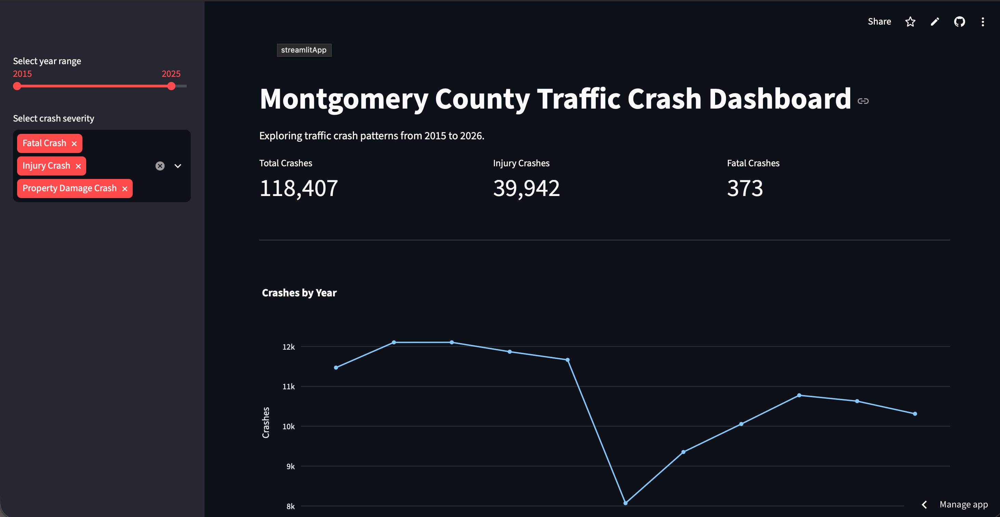

# Montgomery County Traffic Crash Analysis

An analysis of traffic crash patterns in Montgomery County, Maryland, using public crash reporting data from 2015 through October 2026.

**[View the Interactive Dashboard](https://montgomery-county-crash-analysis.streamlit.app/)**

## Project Overview

I built this project to explore when traffic crashes occur, how their severity varies, and what patterns can be found in the data.

Using over 126,000 crash records from Montgomery County's Open Data portal, I cleaned and explored the dataset with Python, wrote SQL queries to investigate crash trends, and created an interactive dashboard using Streamlit.

This project helped me gain hands-on experience working with a real-world dataset and turning raw information into something easier to understand.

## Tools and Technologies

- **Python:** Data analysis and processing
- **pandas:** Cleaning, filtering, and grouping data
- **Matplotlib:** Creating visualizations
- **SQL / SQLite:** Querying crash records
- **Streamlit:** Building an interactive dashboard
- **Git and GitHub:** Version control and project documentation

## Key Findings

- **Crash severity:** Property damage crashes accounted for approximately 66% of all recorded crashes, while injury crashes accounted for approximately 34%.
- **Time of day:** Recorded crashes were most frequent during afternoon commuting hours, especially around 5 PM.
- **Day of week:** Fridays had the highest number of recorded crashes, while Sundays had the lowest.
- **Yearly trends:** Recorded crashes decreased substantially in 2020 compared with 2019.
- **Weather:** Clear weather was the most frequently recorded condition during crashes. However, this does not mean clear weather causes more crashes.

## Interactive Dashboard

The dashboard allows users to:

- Filter crashes by year range
- Filter by crash severity
- Compare annual crash totals
- Explore crashes by hour of day
- Examine recorded weather conditions
- View summary statistics for the selected data

**Live Dashboard:** https://montgomery-county-crash-analysis.streamlit.app/

## Data Source

Montgomery County Open Data — Crash Reporting Incidents

https://data.montgomerycountymd.gov/Public-Safety/Crash-Reporting-Incidents-Data/bhju-22kf

The dataset contains 126,010 crash records covering January 2015 through October 7, 2026.

The dashboard defaults to 2015–2025 because 2026 is an incomplete year.

## Limitations

- The dataset records reported crashes, so it may not include every incident.
- Some records contain missing weather or other information.
- Crash counts do not measure risk per driver or vehicle mile traveled.
- Weather conditions recorded during a crash do not establish what caused it.
- Data for 2026 is incomplete.

## What I Learned

Through this project, I practiced cleaning and analyzing data, using SQL to answer questions, creating visualizations, and building a dashboard that other people can interact with.

I also gained experience troubleshooting code, organizing a project, using GitHub, and deploying a Python application online.
